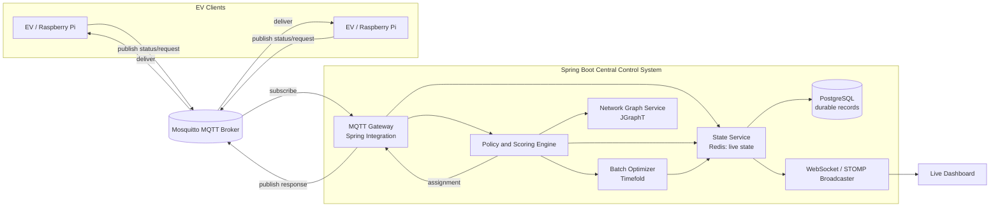
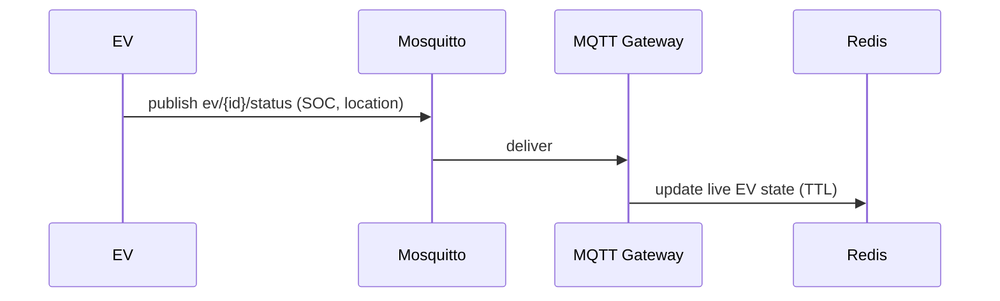
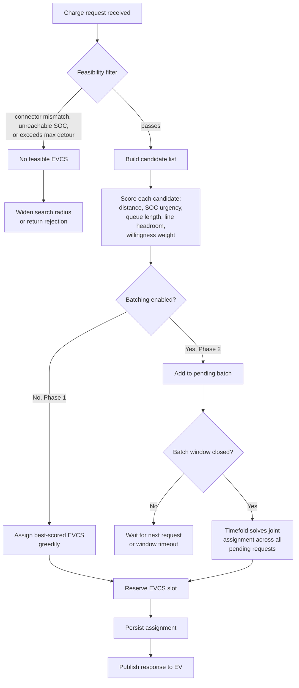
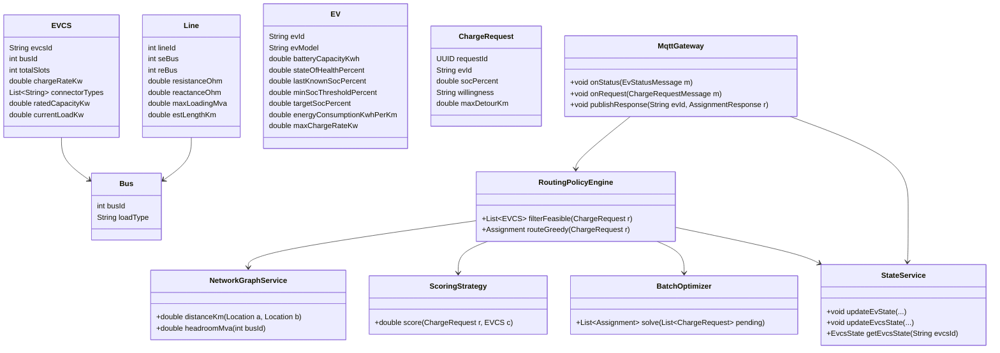

# EV — EVCS Routing System — Architecture & Design

## 1. Overview

A Spring Boot central control system coordinates EV charging assignments across
the 28-bus distribution network defined in Table 1. EVs (real Raspberry Pi
devices later, a Python `paho-mqtt` stand-in app for now) communicate with the
server over MQTT. The server combines live EV/EVCS state, network graph
distance, and per-line electrical capacity to decide where each EV should
charge, then reserves a slot and responds.

**Stack:** Spring Boot (Java) · Eclipse Mosquitto (MQTT) · JGraphT (graph) ·
Timefold (batch optimization) · PostgreSQL (durable state) · Redis (live state)
· Spring WebSocket/STOMP (dashboard push) · Maven.

---

## 2. High-level architecture



---

## 3. MQTT topic design

| Topic | Direction | Payload | QoS |
|---|---|---|---|
| `ev/{evId}/status` | EV → server | SOC, location, willingness (heartbeat) | 0 |
| `ev/{evId}/request` | EV → server | full charge request | 1 |
| `ev/{evId}/response` | server → EV | assignment / reservation / rejection | 1 |
| `evcs/{evcsId}/status` | EVCS → server | availability, queue, current load | 0 |
| `evcs/{evcsId}/command` | server → EVCS | reserve / release slot | 1 |

QoS 1 on anything that changes state (requests, responses, commands); QoS 0 is
fine for high-frequency heartbeats where a missed sample doesn't matter.

### Message payloads

```json
// ev/{evId}/request
{
  "requestId": "uuid",
  "evId": "EV-0231",
  "timestamp": "...",
  "location": {"nodeRef": "bus_6", "offsetKm": 1.2},
  "socPercent": 18,
  "batteryCapacityKwh": 62,
  "evModel": "compact_l2_ccs",
  "willingness": "no_passenger",
  "maxDetourKm": 5
}

// evcs/{evcsId}/status
{
  "evcsId": "EVCS-07",
  "busId": 7,
  "connectorTypes": ["ccs", "chademo"],
  "availableSlots": 2,
  "queueLength": 3,
  "chargeRateKw": 50,
  "currentLoadKw": 140
}

// ev/{evId}/response
{
  "requestId": "uuid",
  "assignedEvcs": "EVCS-07",
  "routeKm": 3.4,
  "etaMin": 9,
  "reservationExpiresAt": "...",
  "reasonCode": "nearest_feasible"
}
```

---

## 4. Data model

```mermaid
erDiagram
    BUS ||--o{ LINE : "sending end"
    BUS ||--o{ LINE : "receiving end"
    BUS ||--o| EVCS : hosts
    EVCS ||--o{ ASSIGNMENT : serves
    EV ||--o{ CHARGE_REQUEST : submits
    CHARGE_REQUEST ||--o| ASSIGNMENT : resolves_to

    BUS {
        int bus_id PK
        string load_type
    }
    LINE {
        int line_id PK
        int se_bus FK
        int re_bus FK
        float resistance_ohm
        float reactance_ohm
        float max_loading_mva
        float est_length_km
    }
    EVCS {
        string evcs_id PK
        int bus_id FK
        int total_slots
        float charge_rate_kw
        string connector_types
        float rated_capacity_kw
        float current_load_kw
    }
    EV {
        string ev_id PK
        string ev_model
        float battery_capacity_kwh
        float state_of_health_percent
        float last_known_soc_percent
        float min_soc_threshold_percent
        float target_soc_percent
        float energy_consumption_kwh_per_km
        float max_charge_rate_kw
    }
    CHARGE_REQUEST {
        uuid request_id PK
        string ev_id FK
        timestamp requested_at
        float soc_percent
        string willingness
        float max_detour_km
        string location_node_ref
        float location_offset_km
    }
    ASSIGNMENT {
        uuid assignment_id PK
        uuid request_id FK
        string evcs_id FK
        timestamp reserved_at
        timestamp expires_at
        string status
    }
```



---

## 5. Sequence — status heartbeat



## 6. Sequence — charge request and routing

```mermaid
sequenceDiagram
    participant EV
    participant Broker as Mosquitto
    participant GW as MQTT Gateway
    participant Policy as Policy Engine
    participant Graph as JGraphT Service
    participant Redis
    participant Opt as Timefold Optimizer
    participant DB as PostgreSQL

    EV->>Broker: publish ev/{id}/request
    Broker->>GW: deliver
    GW->>Policy: ChargeRequest
    Policy->>Redis: read EVCS live status
    Policy->>Graph: distance(EV location, candidate EVCS)
    Graph-->>Policy: distances
    Policy->>Policy: filter feasible and score
    alt batch window open
        Policy->>Opt: add to pending batch
        Opt->>Opt: solve joint assignment at window close
        Opt-->>Policy: assignments
    else immediate / greedy mode
        Policy->>Policy: pick best-scored EVCS
    end
    Policy->>Redis: reserve slot
    Policy->>DB: persist Assignment
    Policy->>GW: response payload
    GW->>Broker: publish ev/{id}/response
    Broker->>EV: deliver assignment
```

---

## 7. Routing algorithm flow



**Scoring notes:**
- **Feasibility filters** (hard, not scored): connector/model compatibility,
  EVCS has a slot or acceptable queue, distance within `maxDetourKm`, SOC
  sufficient to reach the station.
- **Score weights**: distance/ETA, SOC urgency (lower SOC narrows and
  prioritizes the candidate set), EVCS queue length, and **remaining headroom
  on the line feeding that EVCS's bus** (`max_loading_mva` from Table 1 minus
  current flow) — this is what ties the routing decision to real electrical
  capacity instead of just geography.
- **Willingness** modulates rather than filters: `has_passenger` weights
  toward minimal detour; `no_passenger` can be routed further if it improves
  network-wide balance.

---

## 8. Core domain classes



---

## 9. Phased build plan

1. **Data & graph layer** — Bus/Line/EVCS/EV JPA entities, JGraphT graph built
   from Table 1, distance queries between any two graph locations.
2. **MQTT plumbing** — Spring Integration MQTT inbound/outbound adapters,
   topic routing, DTO (de)serialization, a Python `paho-mqtt` dev-stub acting
   as a simulated EV (and one acting as a simulated EVCS).
3. **State service** — Redis for live state (TTL-based staleness handling for
   heartbeats), Postgres for durable records.
4. **Greedy policy engine (Phase 1)** — feasibility filter + scoring,
   immediate assignment, full request → response loop over MQTT working
   end-to-end.
5. **Batch optimizer (Phase 2)** — Timefold-based joint assignment across a
   request batching window.
6. **Dashboard** — WebSocket/STOMP broadcast of live EV/EVCS/assignment state
   to a simple browser view.
7. **Load/capacity coupling** — feed active EVCS charging load back into
   per-line MVA headroom so the policy engine actually respects Table 1's
   max line loading, not just distance.

---

## 10. Source network data (Table 1 — 28-bus distribution network)

| Line | SE bus | RE bus | R (Ω) | X (Ω) | Max loading (MVA) | Peak load at RE (MVA) |
|---|---|---|---|---|---|---|
| 1 | 1 | 2 | 1.179 | 0.820 | 1.5 | 0.050 |
| 2 | 2 | 3 | 1.796 | 1.231 | 1.3 | 0.020 |
| 3 | 3 | 4 | 1.306 | 0.895 | 1.1 | 0.050 |
| 4 | 4 | 5 | 1.851 | 1.266 | 0.8 | 0.020 |
| 5 | 5 | 6 | 1.524 | 1.044 | 0.7 | 0.050 |
| 6 | 6 | 7 | 1.905 | 1.305 | 0.6 | 0.050 |
| 7 | 7 | 8 | 1.197 | 0.820 | 0.5 | 0.050 |
| 8 | 8 | 9 | 0.653 | 0.447 | 0.4 | 0.020 |
| 9 | 9 | 10 | 1.143 | 0.783 | 0.3 | 0.020 |
| 10 | 4 | 11 | 2.823 | 1.172 | 0.5 | 0.080 |
| 11 | 11 | 12 | 1.184 | 0.491 | 0.4 | 0.050 |
| 12 | 12 | 13 | 1.002 | 0.416 | 0.3 | 0.050 |
| 13 | 13 | 14 | 0.455 | 0.189 | 0.2 | 0.020 |
| 14 | 14 | 15 | 0.546 | 0.227 | 0.1 | 0.050 |
| 15 | 5 | 16 | 2.550 | 1.058 | 0.1 | 0.050 |
| 16 | 6 | 17 | 1.366 | 0.567 | 0.5 | 0.013 |
| 17 | 17 | 18 | 0.819 | 0.340 | 0.4 | 0.013 |
| 18 | 18 | 19 | 1.548 | 0.642 | 0.3 | 0.050 |
| 19 | 19 | 20 | 1.366 | 0.567 | 0.2 | 0.050 |
| 20 | 20 | 21 | 3.522 | 0.340 | 0.1 | 0.020 |
| 21 | 7 | 22 | 1.548 | 0.642 | 0.5 | 0.050 |
| 22 | 22 | 23 | 1.092 | 0.453 | 0.4 | 0.013 |
| 23 | 23 | 24 | 0.910 | 0.378 | 0.3 | 0.080 |
| 24 | 24 | 25 | 0.455 | 0.189 | 0.2 | 0.013 |
| 25 | 25 | 26 | 0.364 | 0.151 | 0.1 | 0.050 |
| 26 | 8 | 27 | 0.546 | 0.226 | 0.2 | 0.050 |
| 27 | 27 | 28 | 0.273 | 0.113 | 0.1 | 0.050 |

Estimated line lengths (km, from the earlier conversation, assuming
R ≈ 0.4 Ω/km) can be regenerated the same way if needed — they aren't
required for the routing math itself, only for a more realistic distance
estimate if real conductor data isn't supplied.
# Implemented V2G extension

The current grid-connected research architecture, authoritative session ledger,
units, Weasel provenance, dispatch equations and implementation boundaries are
documented in [v2g-research.md](v2g-research.md). The original charging design
below is historical; the extension document records shared correctness changes.
